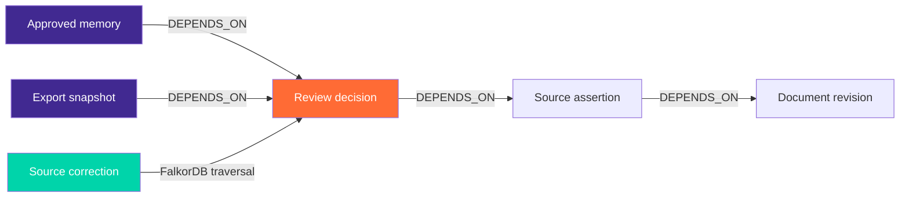

<div align="center">

# 🔥 ClearanceX — Context Agent

### *When shipment evidence changes, your AI should change its mind.*

[](https://www.wemakedevs.org/hackathons/falkordb)
[](https://falkordb.com)
[](https://fastapi.tiangolo.com)
[](https://react.dev)
[](https://www.postgresql.org)
[](https://platform.openai.com)
[](https://docs.docker.com/compose/)
[](LICENSE)

---

**Graph Hacks 2026 · Track 01 — Agents That Act on Connected Data**

**[Open the hosted app](https://clearencexforgraphhacks.vercel.app/)** · Company access is provided by the administrator. [Hosting status and free-plan limits](Docs/HOSTING_STATUS.md).

> ClearanceX connects shipment documents, reviewer decisions and graph dependencies in **FalkorDB**.
> An AI agent investigates conflicting values, proposes cited review tasks, and tracks which decisions
> become stale when evidence changes — while preserving every decision that doesn't.

**Correct one source document. Invalidate exactly the approvals that depend on it. Preserve the rest.**

</div>

---

<a id="competition-submission"></a>

## 🏁 Graph Hacks Submission

**Entry: Track 01 — Agents That Act on Connected Data.** FalkorDB supplies the connected evidence and dependency traversal used by the agent and the source-correction workflow. Persistent approved memory supports this entry; we are not claiming a completed multi-agent coordination or Company Brain product.

| Required deliverable | Where to find it | Status |
|---|---|---|
| Public source-code repository | [Ants-riseup/ClearenceX_for_Graph_Hacks](https://github.com/Ants-riseup/ClearenceX_for_Graph_Hacks) · public `main` branch | Available |
| README with setup instructions and graph data model | [Local setup](#local-setup) · [Graph data model](#graph-data-model) · [Detailed setup](Docs/LOCAL_SETUP.md) | Included |
| Cypher queries or graph algorithms the product depends on | [Essential queries and dependency algorithm](#essential-queries) · [Query source directory](backend/context_app/queries/) | Included |
| Demo video showing the working project | [Demo video status and recording flow](#demo-video) | **Pending: actual public video URL required** |
| Live deployment, or complete local setup | [Open ClearanceX](https://clearencexforgraphhacks.vercel.app/) · [Deployment status](Docs/HOSTING_STATUS.md) · [Local setup](#local-setup) | Deployed; local instructions included |
| Track being entered | **Track 01 — Agents That Act on Connected Data** | Declared |

**Project blog:** [When Shipment Evidence Changes, Your AI Should Change Its Mind](https://clearencexforgraphhacks.vercel.app/blog/clearancex-falkordb).

The hosted app uses administrator-provided customer accounts. Judges can also run the complete local setup and create their own private demo account. Hosting readiness and administrator sign-in are verified; the scope of cloud workflow testing and free-tier limits is recorded in [HOSTING_STATUS.md](Docs/HOSTING_STATUS.md).

This checklist maps to the [official submission requirements](https://www.wemakedevs.org/hackathons/falkordb/rules). The entry is not submission-complete until a real demo video is linked. Inherited work and AI assistance are disclosed [below](#ai-assistance-disclosure) and in the [implementation record](Docs/GRAPH_HACKS_DELTA.md).

---

## 📋 Table of Contents

| Section | Description |
|---|---|
| [🏁 Submission checklist](#competition-submission) | Repository, setup, graph, queries, video, deployment and track |
| [🎯 The Problem](#-the-problem) | Why connected decisions matter |
| [⚡ How It Works](#-how-it-works) | The 6-step investigation lifecycle |
| [🔐 Demo Login Credentials](#-demo-login-credentials) | Sign in immediately — credentials inside |
| [🚀 Quick Start](#local-setup) | Reproducible local startup and account creation |
| [🕸️ Why a Graph?](#graph-data-model) | The dependency model explained |
| [🔎 Essential Cypher queries](#essential-queries) | Executed query files and selective invalidation algorithm |
| [🎬 Demo video](#demo-video) | Recording status and the working flow to demonstrate |
| [🤖 The Agent](#-the-agent) | Tools, boundaries and cost controls |
| [🏗️ Architecture](#️-architecture) | Full system design |
| [📊 Evaluation Results](#-evaluation-results) | 19/20 graph vs 13/20 flat — real numbers |
| [🛡️ Security](#️-security) | Argon2id, CSRF, tenant isolation |
| [🧪 Run the Checks](#-run-the-checks) | Test suite and CI |
| [⚙️ Optional Live AI](#live-ai) | OpenAI config with spending ceiling |
| [📦 Implemented Features](#-implemented-features) | Full feature inventory |
| [🗺️ Competition Materials](#️-competition-materials) | Judges, submission, demo |

---

## 🎯 The Problem

An **invoice**, **packing list** and **air waybill** can disagree about the same shipment. A plausible answer is not enough — reviewers need:

- 🗂️ The **original evidence** behind every decision
- 🧾 The **reason** a reviewer chose a value
- 🔗 A way to know if that decision **remains valid** after a correction

ClearanceX treats the review decision as a **graph dependency**, not an isolated chat answer. When a source document changes, the graph knows exactly which decisions depended on it — and marks only those stale.

---

## ⚡ How It Works

```
Invoice 450 kg  ←──────────────┐
Packing List 450 kg  ←─────────┤──► CONFLICT ──► Agent investigates
Air Waybill 440 kg  ←──────────┘                    │
                                                      ▼
                                              Proposes review task
                                                      │
                                              Human approves weight
                                                      │
                                          Packing list corrected → 440 kg
                                                      │
                                    FalkorDB traverses DEPENDS_ON paths
                                                      │
                              ┌──────────────────────────────────────┐
                              │  Weight approval → STALE  ❌          │
                              │  Package count approval → CURRENT ✅  │
                              └──────────────────────────────────────┘
```

| Step | What happens |
|---|---|
| 🔍 **Investigate** | Agent retrieves graph issues and source assertions, proposes a cited review task |
| ✅ **Review** | A person checks the source and approves a value with a reason |
| 📝 **Correct** | A new document revision replaces the current source; old evidence stays in history |
| 🔗 **Follow dependencies** | FalkorDB identifies connected decisions, tasks, memory and export artifacts |
| ♻️ **Re-review** | Affected approvals become stale; unrelated approvals remain current |
| 💾 **Resume** | A later session recalls current approved memory, stale approvals excluded |

> **The synthetic demo:** Invoice/packing list at **450 kg**, air waybill at **440 kg**. Approve packing-list weight and invoice package count, then correct the packing list to 440 kg. Weight approval becomes stale. Invoice package approval survives. That's the graph doing real work.

---

## 🔐 Demo Login Credentials

> A fresh installation has **no shared default account**. Create a private demo login with the command below, then sign in using its generated password.

### ✨ Your Private Demo Workspace

After starting the stack and creating the demo account below, open **http://localhost:8080**:

<table>
<tr><td><b>🌐 URL</b></td><td><code>http://localhost:8080</code></td></tr>
<tr><td><b>📧 Email</b></td><td><code>judge@example.test</code></td></tr>
<tr><td><b>🔑 Password</b></td><td>Generated privately by the setup command</td></tr>
<tr><td><b>👤 Role</b></td><td>User</td></tr>
</table>

**After signing in:**
1. Open **Context Agent → Create synthetic example**
2. Wait for the **Graph synced** ✅ indicator
3. Run investigation → review → correct → observe stale/current split

> 📌 Synthetic PDFs use **precomputed extraction** — they are not live OCR results. This is intentional and labeled.

---

### 🛠️ Create a Fresh Demo Account (judges/evaluators)

Bootstrap a clean workspace with one command:

```sh
docker compose --env-file .env.graphhacks exec api \
  python -m context_app.admin create-user \
  --email judge@example.test \
  --tenant "Synthetic judge workspace" \
  --role user
```

| Field | Value |
|---|---|
| **URL** | http://localhost:8080 |
| **Email** | `judge@example.test` |
| **Password** | *(printed by the command — save it immediately)* |
| **Workspace** | Synthetic judge workspace |

---

### 👑 Full Admin Account (platform access)

```sh
# Step 1 — create operator
docker compose --env-file .env.graphhacks exec api \
  python -m context_app.admin create-user \
  --email operator@example.com \
  --role admin

# Step 2 — grant platform authority
docker compose --env-file .env.graphhacks exec api \
  python -m context_app.admin grant-platform-admin \
  --email operator@example.com
```

| Field | Value |
|---|---|
| **Local URL** | http://localhost:8080 |
| **Live URL** | https://clearencexforgraphhacks.vercel.app |
| **Email** | `operator@example.com` |
| **Password** | *(printed by Step 1 — save it)* |
| **Role** | Platform admin |

---

### 🧪 Demo / Test Credentials

> ⚠️ **For testing and demo purposes only.** Do not use in production.

| Field | Value |
|---|---|
| **Live URL** | https://clearencexforgraphhacks.vercel.app |
| **Email** | `reviewer@clearancex.local` |
| **Password** | `testuser@123` |
| **Role** | Reviewer (read-only demo access) |

> 📁 **Test files** are located in [`Docs/TEST FILE`](./Docs/TEST%20FILE)

Admin dashboard capabilities:
- ➕ **Add customer user** — company name, email, auto-generated password
- 🔍 **Search/filter** by company name, email and status
- ✏️ **Edit** contact details, reset passwords, disable/restore access
- 📜 **Recent activity** log for all admin actions

> ⚠️ **Generated passwords are printed once.** Save privately. They are stored as Argon2id hashes — not recoverable in plain text.

---

### 🔄 First-Login Password Flow (customer accounts)

Customer accounts created via the dashboard receive a **temporary password**. On first login, they are redirected to `/auth/change-password` and must choose a **10–128 character password** before shipment APIs unlock. This rotates session/CSRF credentials and revokes prior sessions.

---

<a id="local-setup"></a>

## 🚀 Quick Start

**Requirements:** Docker + Compose, Node.js 24, internet for initial pulls.
No paid hosting, managed database or auth subscription needed.

```sh
# 1. Clone
git clone https://github.com/Ants-riseup/ClearenceX_for_Graph_Hacks.git
cd ClearenceX_for_Graph_Hacks

# 2. Generate private DB credentials
npm run setup:local

# 3. Start the canonical four-service stack
docker compose -f compose.yaml --env-file .env.graphhacks up --build -d

# 4. Check that the services are ready
docker compose -f compose.yaml --env-file .env.graphhacks ps

# 5. Create a private local customer workspace for the demo
docker compose -f compose.yaml --env-file .env.graphhacks exec api \
  python -m context_app.admin create-user \
  --email judge@example.test --tenant "Synthetic judge workspace" --role user
```

Open **http://localhost:8080/auth/signin** and use `judge@example.test` with the generated password printed by step 5. This command creates a **local** account; it does not add a user to the hosted deployment. On an existing installation, reuse your existing account instead of repeating account creation.

In **Context Agent**, choose **Create synthetic example**, wait for graph synchronization, then investigate, review and apply the packing-list correction. The synthetic example uses labeled precomputed extraction. For actual digital-PDF extraction, upload PDFs through **Upload a dossier**. Live AI investigation is optional and requires the separate [model configuration](#live-ai); deterministic graph evidence and human review work without paid model calls.

> **Windows without Node.js?** Use PowerShell:
> ```powershell
> powershell -ExecutionPolicy Bypass -File scripts/setup-local.ps1
> ```

**Services started:**

| Service | Port | Description |
|---|---|---|
| 🌐 Frontend (nginx + React) | `localhost:8080` | The main UI |
| ⚡ API (FastAPI) | `localhost:8000` | Backend (loopback only) |
| 🗄️ PostgreSQL 16 | internal | Identity, history, outbox |
| 🕸️ FalkorDB v4.12 | internal | Graph context store |

[→ Complete setup, migrations, optional MCP/OCR and recovery](Docs/LOCAL_SETUP.md)

---

<a id="graph-data-model"></a>

## 🕸️ Why a Graph?

**Primary graph database: FalkorDB.** PostgreSQL holds authoritative records, account ownership, jobs and the projection outbox. Each authenticated tenant has a backend-selected `clearancex_<tenant UUID>` graph. Nodes are scoped by shipment and immutable snapshot revision; keys combine shipment, revision and node identity. Assertion payloads preserve raw/normalized values, units, source IDs and page references. PDF bytes and private filesystem paths are excluded from graph context.

The outbox projects a complete snapshot before publishing `graph_revision`. Graph-dependent actions require the current dossier and graph revisions to match. [Full node properties, tenant boundaries, projection and recovery](Docs/GRAPH_MODEL.md).



### Full Graph Schema

```text
Shipment -HAS_DOCUMENT-> Document -CONTAINS-> Assertion
Shipment -HAS_FIELD-> CanonicalField <-ASSERTS_VALUE_FOR- Assertion
RuleEvaluation -EVALUATES-> CanonicalField
RuleEvaluation -USES_RULE-> Rule
RuleEvaluation -SUPPORTED_BY-> Assertion
ReviewTask -ABOUT-> CanonicalField
ReviewTask -DEPENDS_ON-> Assertion
Decision -RESOLVES-> ReviewTask
Decision -BASED_ON/DEPENDS_ON-> Assertion -DEPENDS_ON-> Document
Memory -DERIVED_FROM/DEPENDS_ON-> Decision
AgentRun -INVESTIGATED-> Shipment
AgentRun -RETRIEVED-> Assertion
AgentRun -PROPOSED-> ReviewTask
AgentRun -RECALLED-> Memory
ExportSnapshot -DEPENDS_ON-> Decision
GoodsReview -DEPENDS_ON-> Assertion (invoice row + packing source)
```

**Why this matters:** The impact query follows `DEPENDS_ON` paths of **1–4 edges** before any source change commits. If graph connectivity fails or more than 100 affected artifacts would be returned, the operation fails without applying partial invalidation.

Essential executed queries: [`evidence`](backend/context_app/queries/evidence.cypher) · [`impact`](backend/context_app/queries/impact.cypher) · [`memory`](backend/context_app/queries/memory.cypher) · [full schema](Docs/GRAPH_MODEL.md)

> **No SQL fallback.** Missing or unsynchronized graph context fails explicitly — it never silently switches to SQL or canned answers.

---

<a id="essential-queries"></a>

## 🔎 Essential Cypher Queries and Graph Algorithm

These are the saved queries executed by the product through [`GraphRepository`](backend/context_app/graph.py). Caller values are bound parameters; labels and relationship types come from fixed application code. The agent does not generate arbitrary Cypher.

| Query source | Product dependency |
|---|---|
| [`evidence.cypher`](backend/context_app/queries/evidence.cypher) | Retrieves active source assertions for a canonical field, scoped to shipment and revision. |
| [`issues.cypher`](backend/context_app/queries/issues.cypher) | Retrieves field context and comparison statuses used to investigate discrepancies. |
| [`rules.cypher`](backend/context_app/queries/rules.cypher) | Connects a field's rule evaluations to the comparison rule and its version. |
| [`memory.cypher`](backend/context_app/queries/memory.cypher) | Retrieves active approved memory linked to decisions; the repository also checks memory expiry. |
| [`impact.cypher`](backend/context_app/queries/impact.cypher) | Follows one to four dependency edges to find decisions, memory, tasks, goods reviews and exports affected by a source revision. |
| [`visual.cypher`](backend/context_app/queries/visual.cypher) | Retrieves the current shipment snapshot for the graph explorer. |

The core traversal in `impact.cypher` is:

```cypher
MATCH (s:Shipment {id:$shipment_id, revision:$revision})
      -[:HAS_DOCUMENT]->(source:Document {id:$source_id})
MATCH (affected)-[:DEPENDS_ON*1..4]->(source)
WHERE affected.shipment_id = $shipment_id
  AND affected.revision = $revision
  AND (affected:Decision OR affected:Memory OR affected:ReviewTask
       OR affected:ExportSnapshot OR affected:GoodsReview)
RETURN DISTINCT affected.id, affected.payload
ORDER BY affected.id
LIMIT 101
```

The excerpt shows the dependency traversal; the [complete executed query](backend/context_app/queries/impact.cypher) also returns each artifact's type.

**Selective invalidation algorithm:**

1. Authorize and lock the dossier, then check the caller's expected revision.
2. Query FalkorDB for artifacts depending on the source being replaced.
3. Reject the change if graph context is unavailable or the result exceeds the 100-artifact safety limit; `LIMIT 101` detects overflow.
4. Mark affected current decisions and pending tasks stale, invalidate dependent goods reviews, and preserve unrelated approvals. Derived stale memory is excluded from subsequent recall. Export artifacts remain bound to their source revision.
5. Archive the old document, save the replacement, and enqueue the next graph snapshot in the same database transaction. Graph-dependent actions wait for synchronization.

For implementation and reproducible checks, see [`service.py`](backend/context_app/service.py), [the graph model](Docs/GRAPH_MODEL.md) and [the judge guide](Docs/JUDGE_GUIDE.md).

---

<a id="demo-video"></a>

## 🎬 Demo Video

**Recording URL: pending — no actual published demo video has been supplied.**

The [recording script](Docs/DEMO.md) is ready. It is preparation material, not a completed video. Add the actual public video link here before submitting, and confirm that it plays without account access.

The recording should show the working application:

1. Sign in to a customer workspace and open a synthetic shipment dossier.
2. Show the invoice/packing-list 450 kg versus transport-document 440 kg conflict and its PDF evidence.
3. Run the configured AI investigation; show real tool activity, citations and a pending review task.
4. Approve packing-list weight and a separate invoice package-count decision as a human reviewer.
5. Correct the packing list to 440 kg; show graph-derived impact, stale weight approval and the unaffected package-count approval.
6. Reopen the dossier to show current approved memory and retained review history; show the essential Cypher and evaluation evidence.

Label precomputed synthetic extraction clearly. Only describe an AI investigation as successful when its actual run and trace are shown. Follow the submission form's real video-length limit.

---

## 🤖 The Agent

### Six Typed Tools

| Tool | What it does |
|---|---|
| `get_issues` | Retrieves conflicts and rule evaluations from FalkorDB |
| `get_evidence` | Fetches source assertions with page citations |
| `get_rules` | Returns applicable comparison policy and versions |
| `get_memory` | Recalls current (non-stale) approved memory for the dossier |
| `get_impact` | Traverses DEPENDS_ON to find affected decisions before correction |
| `get_proposals` | Lists pending review tasks the agent previously proposed |

### Hard Boundaries

```
✅ Agent CAN:  investigate · cite evidence · propose review tasks · recall memory
❌ Agent CANNOT: approve · transmit declarations · execute arbitrary Cypher · switch tenants
```

### Cost Controls

```dotenv
AGENT_BUDGET_USD=0.25          # App-level spending ceiling
MODEL_INPUT_USD_PER_MILLION=0.40
MODEL_OUTPUT_USD_PER_MILLION=1.60
OPENAI_AGENT_MODEL=gpt-4.1-mini-2025-04-14
```

- Max **6 tool invocations** per run
- Max **1 final-answer repair** (bounded, billed)
- **Sequential calls only** — no parallel model escalation
- Shared **database ledger** reserves estimated cost before dispatch
- Citation IDs are **constrained to actually retrieved IDs** and re-checked
- Unknown outcomes retain a **conservative charge** — no silent cost leakage

---

## 🏗️ Architecture

```text
┌──────────────────────────────────────────────────────────┐
│                   React / TypeScript                      │
│              (Vite · same-origin API · CSRF)              │
└─────────────────────────┬────────────────────────────────┘
                           │ opaque session cookie
                           ▼
┌──────────────────────────────────────────────────────────┐
│                     FastAPI                               │
│   session · tenant · role · CSRF · origin checks         │
│                                                          │
│  ┌─────────────────┐   ┌──────────────────────────────┐ │
│  │   PostgreSQL     │   │  Durable projection worker   │ │
│  │  identity        │   │  (PostgreSQL outbox → graph) │ │
│  │  source history  │   └──────────────┬───────────────┘ │
│  │  decisions       │                  ▼                  │
│  │  jobs / usage    │   ┌──────────────────────────────┐ │
│  │  outbox          │   │         FalkorDB             │ │
│  └─────────────────┘   │  versioned evidence graph    │ │
│                          │  dependency traversal        │ │
│  ┌─────────────────┐   └──────────────┬───────────────┘ │
│  │  Private PDFs    │                  │ typed tools      │
│  │  (bounded        │   ┌─────────────┴─────────────┐   │
│  │   extraction)    │   │  Bounded AI agent          │   │
│  └─────────────────┘   │  OpenAI gpt-4.1-mini       │   │
│                          │  → pending proposal        │   │
│                          │  → human approval          │   │
│                          └───────────────────────────┘   │
└──────────────────────────────────────────────────────────┘
                           │ optional
                           ▼
              stdio MCP server (same 6 tools)
              authenticated · read-only · no approve
```

### Data Responsibilities

| Store | Owns |
|---|---|
| **PostgreSQL** | Users, memberships, sessions, dossier metadata, immutable extraction revisions, authoritative approvals, task status, audit events, graph-update outbox |
| **FalkorDB** | Evidence relationships, dependency graph, agent run provenance, approved memory, export snapshot dependencies |
| **Private volume** | Original PDFs, content hashes — no public directory listing, no unauthenticated URL |

---

## 📊 Evaluation Results

### Post-Development Acceptance Set (frozen first run)

> 10 dossiers · 20 questions · same model · graph vs flat · frozen before execution

Same-team authored after earlier development; not independent third-party validation. It was not used to tune the application/model prompt after viewing these outcomes. Since execution, it is regression data, not an unseen test set.

| Metric | 🕸️ Graph | 📄 Flat |
|---|---:|---:|
| **Safe outcomes** | **19 / 20** | **13 / 20** |
| Expected citation hits | 36 / 36 | 36 / 36 |
| Input tokens | 30,149 | 51,461 |
| Output tokens | 3,412 | 4,626 |
| Median latency | 1,922 ms | 2,321 ms |
| Estimated cost (USD) | $0.0175 | $0.0280 |

**Combined: $0.0455048 · Model: `gpt-4.1-mini-2025-04-14`**

> **Graph used ~41% fewer input tokens** — because it retrieves scoped evidence subgraphs instead of full document text.

**What failed:** Both modes failed the repeated-correction gross-weight question (returned two historical affected decision IDs instead of just the latest). The failure is **retained and disclosed** — not patched to inflate the score.

**Earlier development comparison:** 12/12 graph vs 10/12 flat on 6 synthetic dossiers (used during debugging, not held-out).

**Test suite status:**
- ✅ **79 backend tests passed**, 1 skipped (Windows stdio MCP — Linux packaged evidence retained separately)
- ✅ **29 frontend interaction tests passed**
- ✅ **38 live customer smoke checks passed** (creation, login, forced password, cross-company denial, PDF extraction)

[→ Frozen protocol, hashes and limits](Docs/ACCEPTANCE_EVALUATION.md) · [Historical evaluation](Docs/EVALUATION.md) · [Recorded evidence](output/verification/)

---

## 🛡️ Security

### Authentication & Sessions
- **Argon2id** password hashing
- **Random opaque session tokens** stored as digests (not JWTs)
- **HttpOnly / SameSite** cookies with expiry and revocation
- Password changes **rotate session + CSRF** credentials and **revoke all prior sessions**

### Authorization
- Server rechecks **company ownership, platform permissions, exact origins, CSRF and revisions** at every action boundary
- **Tenant isolation:** each tenant's FalkorDB graph name is selected by authenticated server code — never a model argument
- **Two-tenant negative tests** confirm cross-company denial

### Document Security
- PDFs served through **authorized routes only** — not public static mounts
- Uploads have **signature, size, page and parser limits**
- Extraction runs in a **credential-isolated subprocess** (2 GiB / 90-second CPU cap on Linux)
- **Not a hardened hostile-file sandbox** — disclosed honestly

### Agent Security
- SQL / Cypher values are **bound parameters** — no model-generated Cypher executed
- Labels and relationship types come from **fixed code allowlists**
- Agent tools are **scoped and restricted** — no approve, no shell, no arbitrary query

| ✅ Supported | ❌ Not claimed |
|---|---|
| Tested digital-document layouts with human review | Arbitrary/scanned PDF accuracy or calibrated confidence |
| Illustrative tariff screen | Maintained official tariffs or regulatory advice |
| Reviewed prototype XML and batch ZIP | Verified ASYCUDA compatibility or customs transmission |
| Same-dossier current/stale memory | Cross-shipment learning, Company Brain or multi-agent handoffs |
| Local security controls and scoped tests | Production certification, MFA or independent penetration test |

> ⚠️ **Before public hosting:** configure HTTPS/Secure cookies, replace exposed credentials, review parser isolation and verify data rights.

---

<a id="live-ai"></a>

## ⚙️ Optional Live AI

Graph evidence, human review, memory and correction work **without inference**. `Run investigation` requires OpenAI API access.

```dotenv
# .env.graphhacks
ENABLE_LIVE_AGENT=true
OPENAI_API_KEY=your_private_project_key
OPENAI_AGENT_MODEL=gpt-4.1-mini-2025-04-14
AGENT_BUDGET_USD=0.25
MODEL_INPUT_USD_PER_MILLION=0.40
MODEL_OUTPUT_USD_PER_MILLION=1.60
```

Then recreate the API container:

```sh
docker compose --env-file .env.graphhacks up -d api
```

> Keys **never belong** in frontend code, logs, prompts or public source. Use a dedicated project key with least-privilege access and rotate it if exposed.

Verify model availability and [current pricing →](https://platform.openai.com/docs/pricing)

---

## 📦 Implemented Features

### Core Graph & Agent
- ✅ Real tenant-scoped FalkorDB snapshots with versioned revisions
- ✅ Durable PostgreSQL outbox → idempotent graph projection worker
- ✅ Selective source-change invalidation (affected ≠ unrelated)
- ✅ Six typed, parameterized Cypher tools (no model-generated Cypher)
- ✅ Live OpenAI tool selection with bounded context, output and tool limit
- ✅ Citation ID constraints checked against actually retrieved IDs
- ✅ Persisted pending proposals — human approval boundary enforced
- ✅ Authenticated stdio MCP server (same 6 tools, no approve/shell)

### Authentication & Accounts
- ✅ Argon2id passwords, opaque sessions, HttpOnly/SameSite cookies
- ✅ CSRF + exact-origin checks at every mutation endpoint
- ✅ Platform admin vs customer user separation
- ✅ Customer onboarding with first-login forced password change
- ✅ Admin dashboard: add / search / edit / reset / disable / restore users
- ✅ Password reset rotates session/CSRF and revokes all prior sessions

### Document Processing
- ✅ Digital-PDF text extraction across pages (no OCR required for digital)
- ✅ Pipe-delimited goods rows with page/row provenance
- ✅ Credential-isolated extraction subprocess with resource limits
- ✅ Resumable upload monitoring with per-document error states
- ✅ Private authorized PDF routes — no public static mount

### Review & Decisions
- ✅ Source-linked review with competing-value comparison
- ✅ Private review drafts with next-unresolved-field navigation
- ✅ Document corrections, replacement history and type/reference controls
- ✅ Versioned workspace settings — tolerance changes make affected approvals stale
- ✅ Approved memory with current/stale state tracking

### Export & Audit
- ✅ Immutable revision-bound export snapshots
- ✅ Per-dossier batch ZIP results with manifest
- ✅ Audit events with real stored records
- ✅ Source-linked goods review with HS code, origin and item weights
- ✅ Prototype XML preparation (not verified against official ASYCUDA)

### Operations
- ✅ 8 ordered transactional PostgreSQL migrations with rollback protection
- ✅ Graph reconstruction on restart (outbox retries with backoff)
- ✅ Backup/restore scripts (PostgreSQL dump + FalkorDB RDB snapshot + private PDFs)
- ✅ Source package with SHA-256 manifest, excludes private env/PDFs

[→ Customer flow](Docs/ADMIN_CUSTOMER_FLOW.md) · [Implementation delta](Docs/GRAPH_HACKS_DELTA.md)

---

## 🧪 Run the Checks

Use **Python 3.11**, **Node 24** and isolated services.

```sh
# Backend
python -m venv .venv
# Windows: .venv\Scripts\python.exe
.venv/bin/python -m pip install -r backend/requirements-test.txt -r backend/requirements-mcp.txt

# Frontend
npm --prefix frontend ci

# Isolated test infrastructure (ports 5449 + 6399)
npm run test:infra

# All tests
npm test          # backend integration suite
npm run test:ui   # 29 frontend interaction tests
npm run build     # TypeScript + Vite production build
npm run lint      # ESLint — no errors, 9 existing React warnings
```

**What's tested:**

| Suite | Result |
|---|---|
| Backend integration | ✅ 79 passed, 1 skipped (Windows stdio) |
| Frontend interaction | ✅ 29 passed |
| Customer smoke (live) | ✅ 38 checks passed |
| Graph/product checks | ✅ 13 checks passed |
| Production build | ✅ passes, no main-chunk size warning |

> Component tests use **simulated DOM/API responses** — they do not replace a real browser walkthrough. [GitHub Actions](.github/workflows/verify.yml) runs backend/frontend/build/lint without a provider key.

---

## 🗺️ Competition Materials

### Judges

| Resource | Link |
|---|---|
| 🌐 Public source repository | [GitHub](https://github.com/Ants-riseup/ClearenceX_for_Graph_Hacks) |
| 🚀 Hosted app | [ClearanceX](https://clearencexforgraphhacks.vercel.app/) |
| 📝 Project blog | [Published article](https://clearencexforgraphhacks.vercel.app/blog/clearancex-falkordb) |
| 🎥 Actual demo video | [Pending recording URL](#demo-video) |
| 📋 Judge guide | [Docs/JUDGE_GUIDE.md](Docs/JUDGE_GUIDE.md) |
| 🎬 Demo script (3-minute) | [Docs/DEMO.md](Docs/DEMO.md) |
| 🧩 Graph model + Cypher | [Docs/GRAPH_MODEL.md](Docs/GRAPH_MODEL.md) |
| ✅ Manual acceptance checklist | [Docs/MANUAL_ACCEPTANCE.md](Docs/MANUAL_ACCEPTANCE.md) |
| 📊 Acceptance evaluation | [Docs/ACCEPTANCE_EVALUATION.md](Docs/ACCEPTANCE_EVALUATION.md) |
| 🚦 Release readiness | [Docs/RELEASE_READINESS.md](Docs/RELEASE_READINESS.md) |
| 📝 Submission draft | [Docs/SUBMISSION.md](Docs/SUBMISSION.md) |
| 🔍 Existing vs new work | [Docs/GRAPH_HACKS_DELTA.md](Docs/GRAPH_HACKS_DELTA.md) |
| 🔎 Evidence (live tool traces) | [output/verification/](output/verification/) |
| ☑️ Submission checklist | [Docs/SUBMISSION_CHECKLIST.md](Docs/SUBMISSION_CHECKLIST.md) |

### Key Evidence Questions

| Question | Evidence |
|---|---|
| Real model-selected tools? | `output/verification/packaged-flow.json` |
| Actual MCP transport + revoked-session denial? | `output/verification/packaged-mcp.json` |
| Fresh cases vs old development set? | `Docs/ACCEPTANCE_EVALUATION.md` |
| Reproducible source? | `Docs/RELEASE_READINESS.md` |
| Existing work + AI contribution? | `Docs/GRAPH_HACKS_DELTA.md` + disclosure below |

### What's New vs Existing

**Retained from before Graph Hacks:**
React review/dossier/audit/export screens; FastAPI + PostgreSQL models; local PDF extraction pipeline; canonical-field resolution; deterministic discrepancy explanations; prototype XML preparation.

**Delivered during Graph Hacks:**
- Opaque auth/CSRF, tenant/role authorization, private PDFs, bounded Linux parser processes
- Actual indexed FalkorDB snapshots, immutable revisions, durable outbox/recovery, parameterized Cypher tools
- Selective source-change invalidation with affected/unaffected approval checks
- Bounded live OpenAI tool selection, citation constraints, one bounded final repair, shared cost accounting
- Authenticated stdio MCP with real client evidence
- Ordered migrations, atomic ingestion, real multipage/pipe-table extraction
- Real sign-in, correction/history/type/reference controls, private drafts, resumable monitoring
- Immutable revision-bound exports, batch ZIP, backup/recovery scripts
- Real database/security/agent tests; packaged live AI and MCP checks; acceptance comparison

**Unfinished roadmap (honest scope):**
General scanned/arbitrary-table OCR, calibrated confidence, full goods editing, licensed tariffs, cross-shipment Company Brain, JWT/MFA, production HTTPS/load, official customs validation and public submission materials.

<a id="ai-assistance-disclosure"></a>

### AI Assistance Disclosure

**Codex assisted** implementation, documentation and tests. Participants remain responsible for reviewing and understanding the source, graph model, queries, architecture and measurements. The repository, hosted app and project blog are public. An actual demo video, registration verification and final competition submission remain separate deliverables. No winning result is promised.

[→ Official rules](https://www.wemakedevs.org/hackathons/falkordb/rules) · [→ Full work plan](GRAPH_HACKS_WORKPLAN.md)

---

<div align="center">

**Built for Graph Hacks 2026 · Team Ants · FalkorDB Track 01**

*"The graph isn't decoration — it's the reason the right decisions survive a correction."*

</div>

this project should be top in Gaph Hack competition ☑️👍⭐
