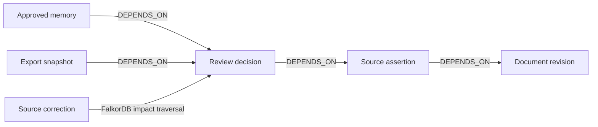

# ClearanceX

### When shipment evidence changes, your AI should change its mind.

**Graph Hacks: Context for AI Agents · Track 01 — Agents That Act on Connected Data**

ClearanceX helps export teams investigate conflicting shipment documents. It connects source assertions, reviewer decisions and their dependencies in **FalkorDB**. An AI agent follows those relationships, explains the evidence and proposes the next review action.

**Correct one source document. Invalidate the approvals that depend on it. Preserve the approvals that do not.** A person remains responsible for approval.

[Judge guide](Docs/JUDGE_GUIDE.md) · [Demo](Docs/DEMO.md) · [Graph model](Docs/GRAPH_MODEL.md) · [Evaluation](Docs/ACCEPTANCE_EVALUATION.md) · [Release status](Docs/RELEASE_READINESS.md)

## The problem

An invoice, packing list and air waybill can disagree about a shipment. A plausible answer is not enough: reviewers need the original evidence, the reason for a decision and a way to know whether that decision remains valid after a correction.

ClearanceX treats the decision as a dependency, rather than an isolated chat answer.

## One change, a visible consequence

| Step | What happens |
|---|---|
| Investigate | The agent retrieves graph issues and source assertions, then proposes a cited review task. |
| Review | A person checks the source and approves a value with a reason. |
| Correct | A new document revision replaces the current source; old evidence stays in history. |
| Follow dependencies | FalkorDB identifies connected decisions, tasks, memory and export artifacts. |
| Re-review | Affected approvals become stale; unrelated approvals remain current. Stale decisions cannot authorize export. |
| Resume | A later session recalls current approved memory without treating stale approvals as current. |

The synthetic demo starts with **450 kg on invoice/packing list and 440 kg on the air waybill**. Approve packing-list weight and invoice package count, then correct the packing list to 440 kg. Weight approval becomes stale; invoice package approval survives.

## Why a graph is necessary



Real tenant-specific, revision-scoped FalkorDB queries gate context lookup, proposals, approval validation and source-change impact. Missing or unsynchronized graph context fails explicitly; it does not switch to SQL or canned answers. Independent screens such as document listing can still work.

The impact query follows `DEPENDS_ON` paths of one to four edges: [impact.cypher](backend/context_app/queries/impact.cypher). Also inspect [evidence](backend/context_app/queries/evidence.cypher), [memory](backend/context_app/queries/memory.cypher) and the [full schema](Docs/GRAPH_MODEL.md).

## Run locally

Requirements: **Docker with Compose**, **Node.js 24** for the cross-platform setup, internet for initial downloads, and sufficient local resources for four services. No paid hosting, managed database or authentication subscription is required.

```sh
git clone https://github.com/Ants-riseup/ClearenceX_for_Graph_Hacks.git
cd ClearenceX_for_Graph_Hacks
npm run setup:local
docker compose --env-file .env.graphhacks up --build -d
```

The clone URL is the configured repository; verify publication of the current release in [release status](Docs/RELEASE_READINESS.md). Windows users without Node can use `powershell -ExecutionPolicy Bypass -File scripts/setup-local.ps1` instead. Both setup commands preserve existing private configuration.

Create a private operator and grant platform authority explicitly:

```sh
docker compose --env-file .env.graphhacks exec api python -m context_app.admin create-user --email operator@example.com --role admin
docker compose --env-file .env.graphhacks exec api python -m context_app.admin grant-platform-admin --email operator@example.com
```

Save the generated password privately. Open **http://localhost:8080**, sign in and use **Add customer user**. Each customer gets its own company workspace and a supplied or generated temporary password. Customer sign-in requires **Choose your own password** before shipment access. Public signup is disabled. Platform operators manage access; customer accounts process shipments.

For a synthetic demonstration without the administration steps, bootstrap an ordinary local account:

```sh
docker compose --env-file .env.graphhacks exec api python -m context_app.admin create-user --email judge@example.test --tenant "Synthetic judge workspace" --role user
```

This operator-only bootstrap prints a generated password and grants no platform privilege. Sign in and open **Context Agent → Create synthetic example**. Wait for **Graph synced**. Generated PDFs have explicitly precomputed extraction; they are not presented as live OCR.

[Complete setup, migrations, optional MCP/OCR and recovery](Docs/LOCAL_SETUP.md)

## Optional live AI, with a spending ceiling

Graph evidence, human review, memory and correction demonstrations work without inference. **Run investigation** requires OpenAI API access and billable requests. An unavailable model produces an error, never a simulated agent answer.

Configure the private `.env.graphhacks` file deliberately:

```dotenv
ENABLE_LIVE_AGENT=true
OPENAI_API_KEY=your_private_project_key
OPENAI_AGENT_MODEL=your_supported_tool_calling_model
AGENT_BUDGET_USD=your_chosen_total_ceiling
MODEL_INPUT_USD_PER_MILLION=verified_input_price
MODEL_OUTPUT_USD_PER_MILLION=verified_output_price
```

Replace every placeholder, verify model availability and [current pricing](https://developers.openai.com/api/docs/pricing), then recreate the API: `docker compose --env-file .env.graphhacks up -d api`. Retained comparisons identify their exact model; no automatic larger-model fallback is enabled.

The agent has six narrow tools, sequential calls, bounded context/output, at most six tool invocations and one final-answer repair. A shared database ledger reserves estimated cost before requests; unknown outcomes retain their conservative charge. This is an application control, not a provider invoice guarantee or a limit on other software using the key. Keys never belong in frontend code or public source.

## Architecture

```text
React / TypeScript
        │ same-origin API, opaque session, CSRF
        ▼
FastAPI ── PostgreSQL: identity, source history, reviews, jobs, usage, outbox
   │       Private storage: authorized PDFs
   └── durable projection worker ── FalkorDB: versioned evidence/dependencies
                                      ▲
                 bounded AI agent ────┘ typed graph tools
                         └── pending proposal → human approval
```

PostgreSQL preserves authoritative history and the durable outbox; FalkorDB supplies connected context and dependency traversal. An optional authenticated **stdio MCP server** exposes the same six tools through normal API authorization. It cannot approve, execute arbitrary code/Cypher or select another tenant.

## Implemented product

- Bounded private digital-PDF upload/extraction, real processing status, retry and resume.
- Source-linked review, document corrections/history, private drafts and versioned settings.
- Graph evidence, dependency previews, investigation traces, pending proposals and approved memory.
- Customer onboarding, first-login password changes, platform/customer separation and private company workspaces.
- Audit events, reviewed-goods checks, immutable prototype export snapshots and per-dossier batch ZIP results.
- Local Compose, ordered migrations, graph reconstruction and documented backup/restore.

The original Overview design is retained. [Customer flow](Docs/ADMIN_CUSTOMER_FLOW.md) · [Implementation record](Docs/GRAPH_HACKS_DELTA.md)

## Evidence and reproducibility

Retained live records demonstrate model-selected tools, cited proposals, selective invalidation, new-session memory and real MCP transport. The original comparison achieved **12/12 graph versus 10/12 flat safe outcomes** on six synthetic development dossiers. It was used during debugging and is **not held-out accuracy**.

A separate post-development acceptance set contains **10 dossiers and 20 questions**. Its first live run scored **19/20 graph versus 13/20 flat**, used approximately **41% fewer input tokens** with graph context and cost **$0.0455 combined**. Both modes failed the repeated-correction impact question; the failure is retained. The frozen protocol, source/dataset hashes and limits are in [ACCEPTANCE_EVALUATION.md](Docs/ACCEPTANCE_EVALUATION.md). This is same-team evaluation, not independent third-party certification or general accuracy.

[Recorded evidence](output/verification/) · [Historical evaluation](Docs/EVALUATION.md) · [Release checks](Docs/RELEASE_READINESS.md)

## Run the checks

Use Python **3.11**, Node **24** and isolated services. On Windows, replace `.venv/bin/python` with `.venv\Scripts\python.exe`:

```sh
python -m venv .venv
.venv/bin/python -m pip install -r backend/requirements-test.txt -r backend/requirements-mcp.txt
npm --prefix frontend ci
npm run test:infra
npm test
npm run test:ui
npm run build
npm run lint
```

Test ports **5449** and **6399** are separate from application services. Contract tests use a labeled scripted provider; paid-model comparisons are explicit, separate runs. Private supplied-PDF regressions skip when files are absent from public source; synthetic extraction, security, graph and export tests remain runnable.

[GitHub Actions](.github/workflows/verify.yml) configures backend/frontend tests, build, lint and source packaging without a provider key. A workflow file alone is not proof of a passing remote run. Component tests use simulated DOM/API responses and do not replace a real browser walkthrough.

## Security and honest limits

Passwords use **Argon2id**. Random opaque session tokens are stored as digests, with HttpOnly/SameSite cookies, expiry and revocation. Server checks enforce company ownership, platform permissions, exact origins, CSRF and revisions. SQL/Cypher values are bound; identifiers and tools are restricted. Password changes rotate session/CSRF credentials and revoke previous sessions.

Documents are untrusted input. Citation IDs and numeric claims are checked. Uploads have signature, size, page and parser limits; extraction runs without provider credentials in a bounded process. It is **not a hardened hostile-file sandbox**.

| Supported demonstration | Not claimed |
|---|---|
| Tested digital-document layouts with human review | Arbitrary/scanned PDF accuracy or calibrated confidence |
| Illustrative tariff screen | Maintained official tariffs or regulatory advice |
| Reviewed prototype XML and batch ZIP | Verified ASYCUDA compatibility or customs transmission |
| Same-dossier current/stale memory | Cross-shipment learning, Company Brain or multi-agent handoffs |
| Local security controls and scoped tests | Production certification, MFA or an independent penetration test |

Before public hosting, configure HTTPS/Secure cookies, replace exposed credentials, review parser isolation and verify data rights. The default UI binds to loopback; databases are not published. Private documents, environment files, passwords and backups must stay out of public source.

## Competition materials and contribution

- [Judge guide](Docs/JUDGE_GUIDE.md), [submission draft](Docs/SUBMISSION.md) and [demo script](Docs/DEMO.md)
- [Manual acceptance](Docs/MANUAL_ACCEPTANCE.md), [graph model](Docs/GRAPH_MODEL.md) and [essential Cypher](backend/context_app/queries/)
- [Existing/new-work disclosure](Docs/GRAPH_HACKS_DELTA.md), [full retained work plan](GRAPH_HACKS_WORKPLAN.md) and [submission checklist](Docs/SUBMISSION_CHECKLIST.md)

ClearanceX existed before this graph-agent extension. The delta record identifies inherited domain/UI infrastructure and new work. The team must verify reuse eligibility, data/assets rights and meaningful participant contribution under the [official rules](https://www.wemakedevs.org/hackathons/falkordb/rules).

**AI assistance:** Codex assisted implementation, documentation and tests. Participants remain responsible for reviewing and understanding the source, graph model, queries, architecture and measurements. Public publication, an actual video, registration and competition submission are separate deliverables tracked in the release report. No winning result is promised.
